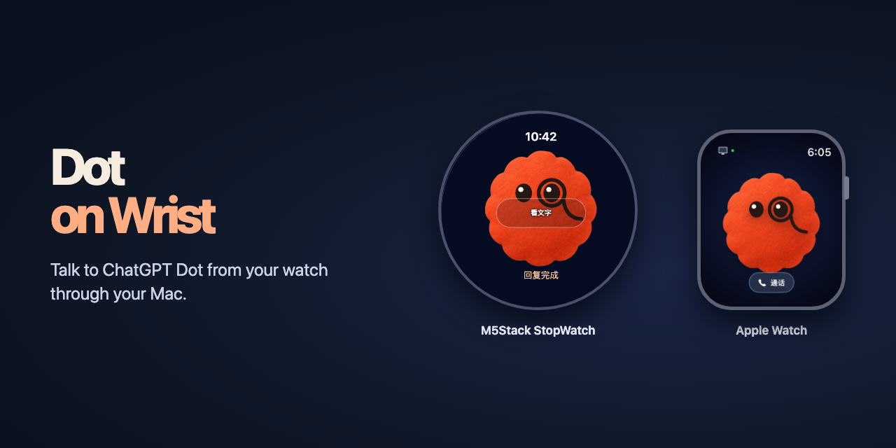

# Dot on Wrist

[简体中文](docs/README.zh-CN.md) · [日本語](docs/README.ja.md)

Talk to your ChatGPT Dot conversation from an M5Stack StopWatch or Apple Watch. A local Mac gateway connects both devices to your signed-in Chrome tab. Hold to ask one question, or start a live voice call. New incoming messages can appear as text and be read aloud.

| Component | Source | Installation |
| --- | --- | --- |
| M5Stack StopWatch | [firmware](firmware/) | Build and flash with PlatformIO by USB |
| Chrome extension | [mac/chrome-extension](mac/chrome-extension/) | Load unpacked and register the local native host |
| Apple Watch | [watchOS](watchOS/) | Build, sign, and run with Xcode |
| Mac gateway | [mac](mac/) | Set up the local Python environment and pairing |

[Installation and usage](docs/INSTALL.md) · [Copy-and-paste prompt for an installation agent](AGENT-INSTALL.md)

English is the default. Build the M5Stack firmware for Simplified Chinese or Japanese by choosing the corresponding PlatformIO environment. The Chrome extension and Apple Watch interface follow their system language. Conversation text comes from Dot. Some troubleshooting messages from the Mac gateway are still in Chinese.

This is an independent community project. The Chrome extension uses the current structure of the Dot page. You need an account with access to the conversation and its voice controls. The Mac must stay online and the tab must stay open. The initial setup targets a trusted local network.

See [LICENSE](LICENSE) and [third-party notices](THIRD_PARTY_NOTICES.md).
