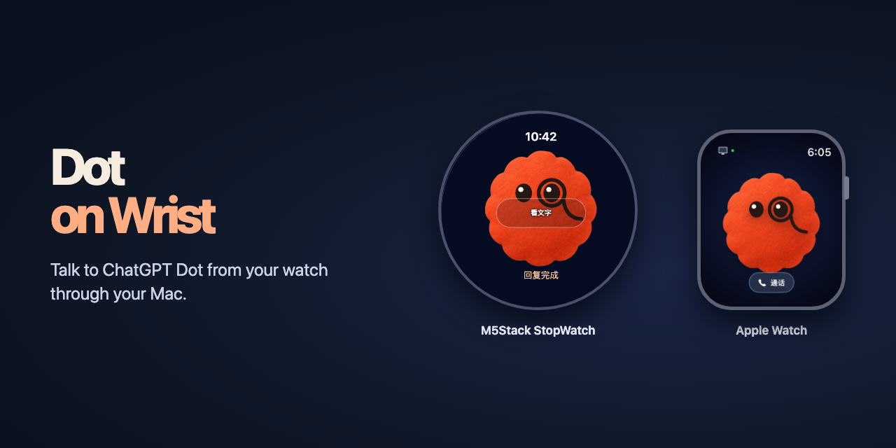

# Dot on Wrist

[English](../README.md) · [简体中文](README.zh-CN.md)



M5Stack StopWatch または Apple Watch から Dot と話せます。Mac 上のゲートウェイが、ログイン済みの Chrome の会話タブに接続します。長押しで質問を送信し、通話ボタンで連続通話を開始できます。新着メッセージは画面に表示し、読み上げます。

1. Mac に Chrome、Python 3.12、BlackHole 2ch を用意し、自分の Dot 会話タブを開きます。セットアップスクリプトでローカルのペアリング情報を作成します。
2. Chrome の拡張機能ページでデベロッパーモードを有効にし、`mac/chrome-extension` を読み込みます。ゲートウェイを起動し、会話タブを開いたままにします。
3. M5Stack は PlatformIO でビルドし、USB で書き込みます。日本語版には `m5stack-stopwatch-ja` を選択します。初回は QR コードで 2.4 GHz Wi-Fi を設定します。
4. Apple Watch は `watchOS/ANNA.xcodeproj` を Xcode で開き、開発チームとペアリング済みの時計を選択して実行します。画面の言語はシステム設定に従います。

M5Stack は黄色ボタンを長押しして話し、離して送信します。青色ボタンで通話を開始・終了できます。Apple Watch は Dot を長押しして話し、下のボタンで通話を開始し、中央のボタンで終了します。Mac と時計は互いに通信できる LAN に接続してください。

## リポジトリのルートで実行

`YOUR_MAC_LAN_IP` を Mac の LAN アドレスに置き換え、自分の ChatGPT Dot の会話 URL を入力します。Apple Watch は Xcode でインストールします。

```sh
python3.12 -m venv .venv
.venv/bin/python -m pip install -r mac/requirements.txt platformio "esptool>=4,<5"
.venv/bin/python scripts/configure.py --host YOUR_MAC_LAN_IP
./scripts/start-gateway.sh
```

[詳しい手順とコマンド](INSTALL.md) · [エージェントに渡すセットアップ依頼](AGENT-INSTALL.ja.md)
