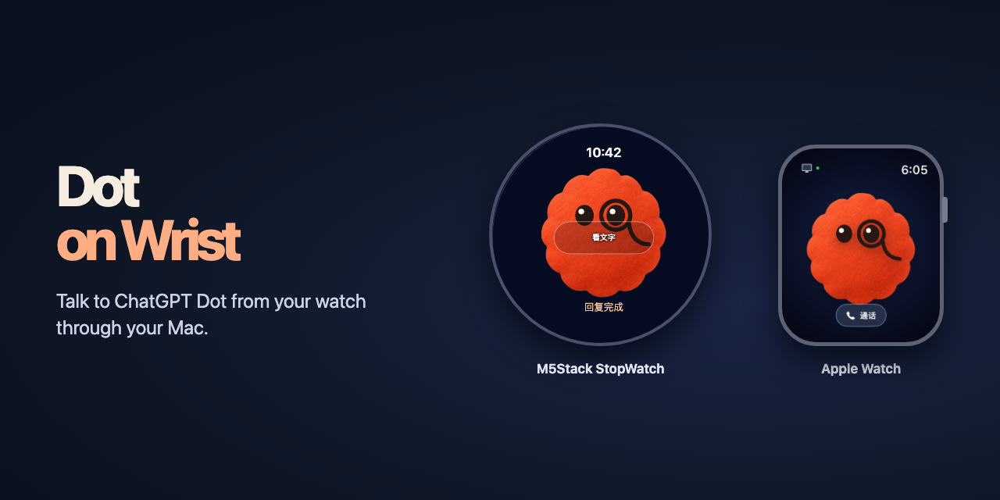

# Dot on Wrist

[English](../README.md) · [日本語](README.ja.md)



在 M5Stack StopWatch 或 Apple Watch 上和 Dot 对话。Mac 网关连接已经登录的 Chrome 对话页面，支持按住说一句、连续通话以及新消息文字和语音提醒。

## M5Stack StopWatch 怎么用

- **左键（黄色）**。按住录一条语音，松手发送。Dot 的回复会显示在屏幕上并朗读。
- **右键（蓝色）**。按一下开始连续通话，再按一下挂断。
- **待机收消息**。StopWatch 连着 Mac 且空闲时，Dot 的新消息可唤醒屏幕、显示文字并朗读。
- **音量、亮度和熄屏**。从屏幕顶部下滑打开设置，拖动滑条调整扬声器音量和屏幕亮度。默认闲置 30 秒自动熄屏。我实测待机大约 4–5 小时，有时更久。续航会随 Wi-Fi 信号、亮度和播报频率变化。
- **常亮模式**。在设置里打开「常亮」，屏幕持续点亮，动画人物也会放大，适合挂在包上当装饰挂件。
- **和人物互动**。在待机画面轻点 Dot，它会做出反应。普通显示模式下还可以揉一揉、拖动，或用手指快速甩出去。

## Apple Watch 怎么用

按住 Dot 录音，松手发送。点「通话」开始连续对话，点「挂断」结束。App 打开且空闲时，可以显示并朗读本次打开后收到的 Dot 新消息。

## 直接复制给 Agent

把下面这段复制给能操作你 Mac 的 Agent。

```text
请在这台 Mac 上帮我安装 Dot on Wrist。项目是 https://github.com/samyeei/dot-on-wrist，先读 docs/INSTALL.md，检查本机环境和已有安装，确认我使用 M5Stack StopWatch、Apple Watch 或两者。从仓库创建 Python 环境并运行配对脚本，我会在隐藏输入框填自己的 Dot 对话地址。加载 Chrome 扩展，启动 Mac 网关并确认扩展显示 ON。M5Stack 先确认型号、串口并备份完整固件，再编译刷写。Apple Watch 用我自己的 Xcode 开发团队签名并装到配对手表。需要我登录、授予系统权限、打开开发者模式或操作设备时再提示我。最后实测一次按住说话、一次连续通话及挂断，告诉我哪些已验证。配对凭据、对话地址、证书私钥、固件备份和已配对的构建只保存在本机。
```

## 户外使用的网络要求

在家里同一个局域网内，手表可以直接连接 Mac。**在外面使用时，Mac 网关需要有手表能访问的公网 IP**，也可以用指向该 IP 的域名。家里的 Mac 要保持在线，Chrome 里保持 ChatGPT Dot 标签页打开。手机热点只给手表提供上网连接，家里的 Mac 网关还需要能从公网访问。默认安装脚本配置的是局域网，户外使用需另行配置公网入口和设备的 TLS 配对。

## 手动安装

1. 在 Mac 上准备 Chrome、Python 3.12 和 BlackHole 2ch。打开你自己的 Dot 对话，用安装脚本在本机生成配对文件。
2. 打开 Chrome 的扩展页面，开启开发者模式并加载 `mac/chrome-extension`。启动 Mac 网关，保持对话标签页打开。
3. M5Stack 用 PlatformIO 构建和刷写，首次开机扫码连接 2.4 GHz Wi-Fi。中文构建选择 `m5stack-stopwatch-zh`。
4. Apple Watch 用 Xcode 打开 `watchOS/ANNA.xcodeproj`，选自己的开发团队和已配对手表，签名后运行。界面跟随系统语言。


## 在仓库根目录执行

把 `YOUR_MAC_LAN_IP` 换成 Mac 的局域网地址。配对脚本会提示输入自己的 ChatGPT Dot 对话地址。Apple Watch 请通过 Xcode 安装。

```sh
python3.12 -m venv .venv
.venv/bin/python -m pip install -r mac/requirements.txt platformio "esptool>=4,<5"
.venv/bin/python scripts/configure.py --host YOUR_MAC_LAN_IP
./scripts/start-gateway.sh
```

[完整安装命令与排查](INSTALL.md)

## 加入社区

扫码加入 Telegram 群。


